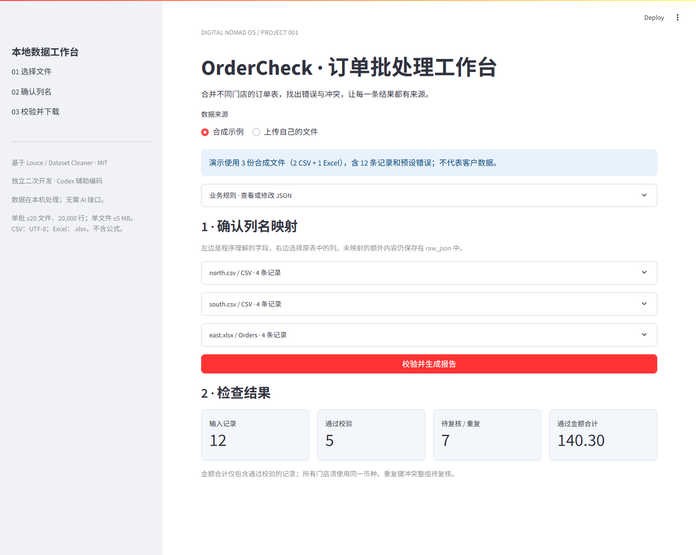

# OrderCheck
### Order data validation, exception review & reporting

A Python application that turns multi-source order files into a repeatable business validation workflow. It combines a Streamlit workbench, a command-line interface and a shared processing core.

[Developer profile & résumé](https://github.com/zhuyy86/leadreview/blob/main/PROFILE.md) · [中文使用文档](USAGE.md) · [Engineering walkthrough](PROJECT_EXPLAINED_FOR_ME.md) · [Test report](TEST_REPORT.md) · [Source & license](UPSTREAM.md)



## Business workflow

**Import → Map fields → Validate → Isolate conflicts → Review → Export**

CSV and Excel exports often disagree on field names, identifiers and values. OrderCheck makes those rules explicit and preserves the information needed to trace each result back to its source.

## Engineering highlights

- **Shared application core:** the UI and CLI use the same ingestion, validation and export pipeline.
- **Configurable domain rules:** JSON configuration controls required fields, aliases, duplicate keys, date formats and amount ranges.
- **Data integrity:** Decimal-based monetary validation, text identifier preservation and whole-group isolation for conflicting duplicate keys.
- **Traceability:** file, worksheet and row provenance; original field values; transformation logs; input SHA-256 hashes and replayable mappings.
- **Review experience:** accepted records, exceptions and changes are separated; changed inputs invalidate stale reports.
- **Delivery outputs:** seven-sheet Excel reports, CSV extracts, JSON summaries and a ZIP package. KPI reporting adds store/day totals and average order value. CLI ZIP reports are staged and file-synced before exclusive publication, preventing partial final reports and overwrites by competing writers. KPI JSON replacement also stages and syncs before publishing, preserving old results on write failure.

## Architecture

```text
Streamlit workbench / CLI
          |
Batch ingestion & field mapping
          |
Configurable validation & conflict resolution
          |
Audit records / Excel, CSV & JSON exports
```

The processing layers separate business decisions from file handling and presentation, making rule changes and regression checks easier to maintain.

## Verification

The current suite passes **78 automated tests**, covering mixed inputs, multiple worksheets, dates, monetary values, duplicate conflicts, exports, UI and CLI behavior. Browser checks exercised upload, validation and download. See [TEST_REPORT.md](TEST_REPORT.md) for the recorded environment and results.

## Run locally

```powershell
py -3.12 -m venv .venv
.\.venv\Scripts\python.exe -m pip install -r requirements-lock.txt
.\.venv\Scripts\python.exe -m streamlit run src/ordercheck_app.py
```

On the prepared Windows workstation, `start-ordercheck.cmd` starts the application. For batch automation and input formats, see the [full usage reference](USAGE.md).

## Stack

Python · pandas · openpyxl · Streamlit · Decimal · pytest

## Development & attribution

Independent portfolio project, developed with Codex assistance as an extension of an MIT-licensed data-cleaning application. The added order workflow, audit reporting, interfaces and tests are described in [UPSTREAM.md](UPSTREAM.md). Original license notices are retained in [LICENSE](LICENSE).
